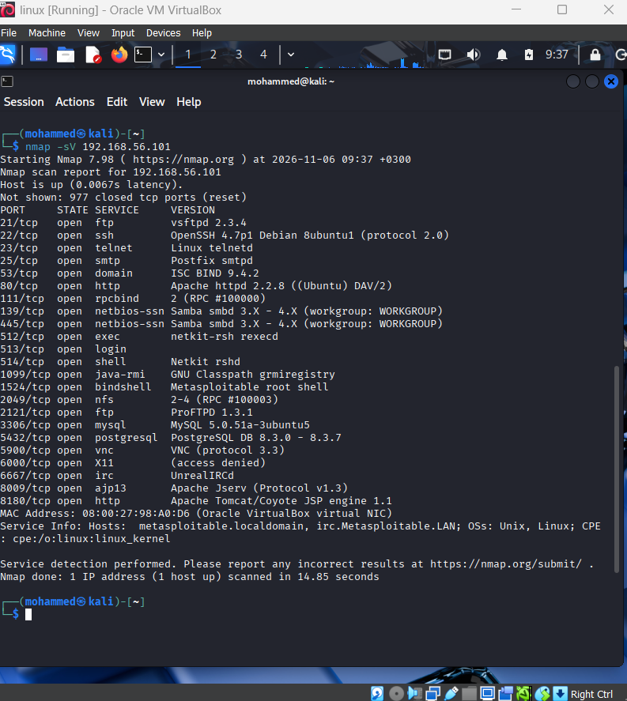
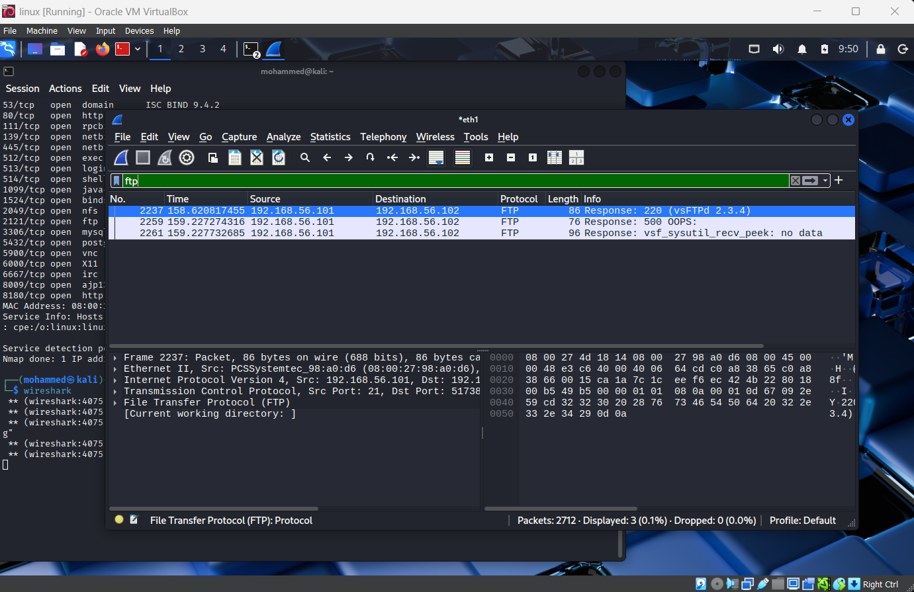
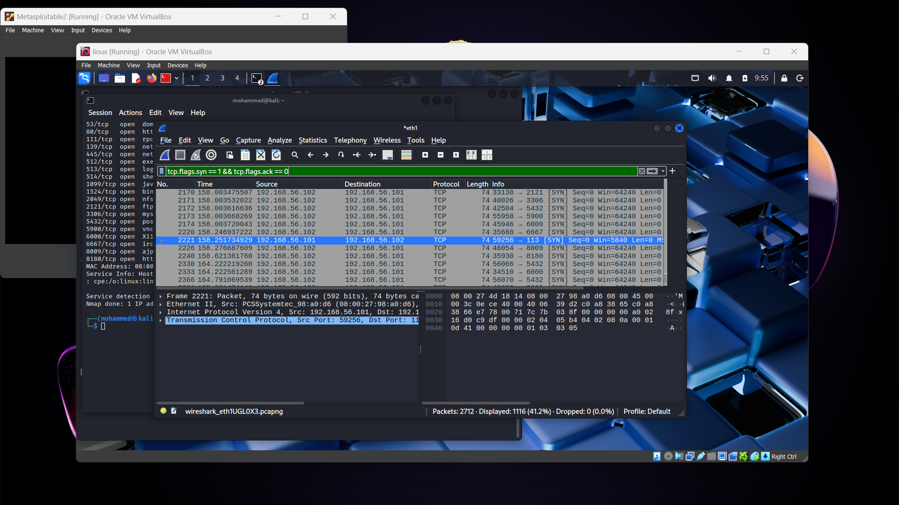

# Home Cybersecurity Lab

A virtual lab I built to practice network scanning, service enumeration and packet analysis in a safe, isolated environment.

> ⚠️ Everything here was done on my own virtual machines. Never scan or test systems you don't own or have written permission to test.

## Lab setup
- **Hypervisor:** Oracle VirtualBox
- **Attacker machine:** Kali Linux (`192.168.56.102`)
- **Target machine:** Metasploitable 2, an intentionally vulnerable Linux VM (`192.168.56.101`)
- **Network:** Both machines share a VirtualBox **host-only network** (`192.168.56.0/24`). Metasploitable has no other network adapter, so it is isolated from my home network and the internet. Kali keeps a second NAT adapter for updates.

## What I practiced
1. **Host discovery and service enumeration** with Nmap (`-sn` and `-sV`).
2. **Packet analysis** with Wireshark, capturing the scan traffic on the host-only interface.
3. **Reading scan results** to identify exposed services and outdated software.

This was enumeration only. I did not exploit anything.

## Findings

| Step | Tool | Command | Result |
|------|------|---------|--------|
| Host discovery | Nmap | `nmap -sn 192.168.56.0/24` | Found the target at `192.168.56.101`, Kali at `.102`, and the host-only network's own devices (`.1`, `.100`) |
| Port and service scan | Nmap | `nmap -sV 192.168.56.101` | **23 open ports** (977 closed), completed in about 15 seconds |
| Traffic capture | Wireshark | filter: `ftp` | Target's FTP server announced `220 (vsFTPd 2.3.4)` in **plain text** |
| Scan pattern | Wireshark | filter: `tcp.flags.syn == 1 && tcp.flags.ack == 0` | 1,116 of 2,712 captured packets were SYN connection attempts from Kali to many different ports |

### Notable services found open
- **Unencrypted remote access:** Telnet (23), rexec/rlogin/rsh (512-514), FTP (21, 2121), VNC (5900)
- **Very old software versions:** vsftpd 2.3.4, OpenSSH 4.7p1, Apache httpd 2.2.8, MySQL 5.0.51a, PostgreSQL 8.3, Samba 3.x
- **Exposed databases and services:** MySQL (3306), PostgreSQL (5432), Tomcat (8180), IRC (6667), NFS (2049)
- **Port 1524:** identified by Nmap as a "Metasploitable root shell"

### Nmap service scan

### Wireshark: FTP banner in plain text

### Wireshark: SYN packets from the port scan

## What I learned
- A default Metasploitable install exposes a very large attack surface: one 15-second scan found 23 open services, many running years-old software.
- Services like FTP and Telnet send data in plain text, so a banner (and in a real attack, credentials) can be read straight from a packet capture.
- With VirtualBox's plain **NAT** mode, VMs are isolated from each other, so my first scan found no target. Switching both machines to a **host-only network** let them communicate while staying isolated from my home network.
- Port scans have a recognisable pattern in Wireshark: a burst of SYN packets from one source to many ports.

## Next steps
- Practise on TryHackMe and prepare for eJPT
- Write up further exercises in this repo
